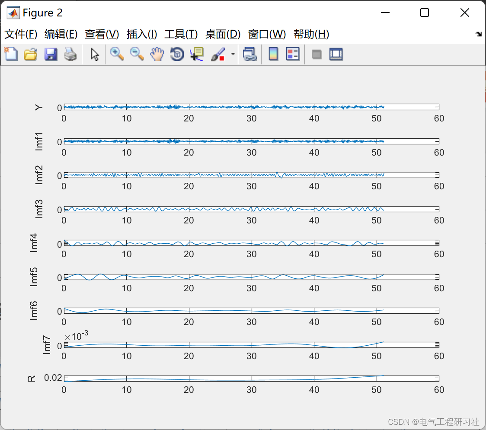
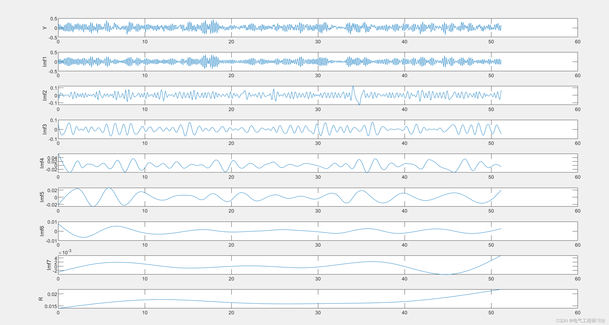
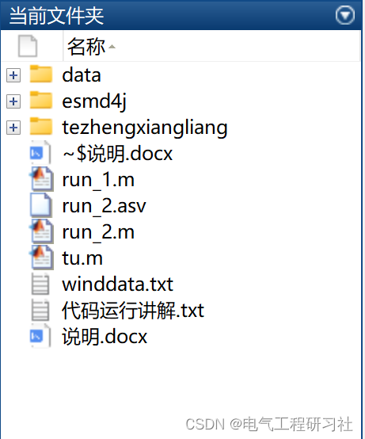

# Equipment Fault Diagnosis Based on LSTM and SVM (Matlab Code Implementation)

​  
1. Overview (The experimental platform includes a 2-horsepower motor (left side) (1hp = 746W), a torque sensor (middle), a power meter (right side) and electronic control equipment (no display). The tested bearing supports the motor shaft. Single point faults were arranged on the bearing using electro-discharge machining technology, with the diameter of the faults being 0.007, 0.014, 0.021, 0.028, 0.040 inches (1 inch = 2.54 cm). The bearings with the first three fault diameters used SKF bearings, while those with the last two fault diameters used equivalent NTN bearings.
(In the experiments, an accelerometer was used to collect vibration signals. The sensor was mounted on the motor housing using a magnetic base. The accelerometers were installed at 12 o'clock positions on both the drive end and the fan end of the motor housing. In some experiments, the sensors were also placed on the motor support base. The vibration signals were recorded by a 16-channel DAT recorder and processed in MATLAB. The sampling frequency for the digital signal was 12000S/s, and the data from the drive end bearing failure was also collected at a sampling rate of 48000S/s.)
(The faults on the outer ring are fixed, so the position of the fault relative to the bearing load area has a direct impact on the vibration response of the motor/bearing system. To quantitatively study this impact, in the experiment, three types of faults were arranged on the outer ring at 3 o'clock, 6 o'clock, and 12 o'clock directions for both drive and fan ends.
2 Data Fault Diameter
Motor Load (HP)
Approx. Motor Speed motor speed (rpm)
Inner Race  
Ball  
Outer Race  
Position Relative to Load Zone (Load Zone Centered at 6:00)  
Centered  
@6:00  
Orthogonal  
@3:00  
Opposite  
@12:00  
0.007"  
0  
1797  
105  
118  
130  
144  
156  
1  
1772  
106  
119  
131  
145  
158  
2  
1750  
107  
120  
132  
146  
159  
3  
1730  
108  
121  
133  
147  
160  
0.014"  
0  
1797  
169  
185  
197  
*  
*  
1  
1772  
170  
186  
198  
*  
*  
2  
1750  
171  
187  
199  
*  
*  
3  
1730  
172  
188  
200  
*  
*  
0.021"  
0  
1797  
209  
222  
234  
246  
258  
1  
1772  
210  
223  
235  
247  
259  
2  
1750  
211  
224  
236  
248  
260  
3  
1730  
212  
225  
237  
249  
261  
0.028"  
0  
1797  
3001  
3005  
*  
*  
*  
1  
1772  
3002  
3006  
*  
*  
*  
2  
1750  
3003  
3007  
*  
*  
*  
3  
1730  
3004  
3008  
*  
*  
*  
Download: 48k Drive End Bearing Fault Data  
* = Data not available  
Fault Diameter  
Motor Load (HP)  
Approx. Motor Speed (rpm)  
Inner Race  
Ball  
Outer Race  
Position Relative to Load Zone (Load Zone Centered at 6:00)  
Centered  
@6:00  
Orthogonal  
@3:00  
Opposite  
@12:00  
0.007"  
0  
1797  
109  
122  
135  
148  
161  
1  
1772  
110  
123  
136  
149  
162  
2  
1750  
111  
124  
137  
150  
163  
3  
1730  
112  
125  
138  
151  
164  
0.014"  
0  
1797  
174  
189  
201  
*  
*  
1  
1772  
175  
190  
202  
*  
*  
2  
1750  
176  
191  
203  
*  
*  
3  
1730  
177  
192  
204  
*  
*  
0.021"  
0  
1797  
213  
226  
238  
250  
262  
1  
1772  
214  
227  
239  
251  
263  
2  
1750  
215  
228  
240  
252  
264  
3  
1730  
217  
229  
241  
253  
265  
3. Matlab runtime results - edit
Editor
4. Matlab code, data article This article only displays a part of the code, all codes can be found in:
Editor
​  

## Images

<!-- PAYMENT_BLOCK -->

## Get this dataset

- Payment link (Stripe): [Buy now](https://buy.stripe.com/3cs8yP7sY87d0vu9AB)
- Payment QR code: 

<!-- /PAYMENT_BLOCK -->
